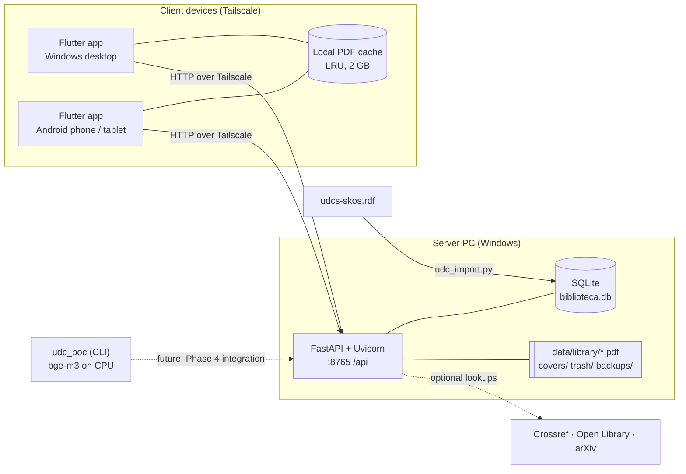

# UDC Library

A self-hosted library for PDF documents (books, theses, articles, patents, standards, music scores and grey literature), organised with the **Universal Decimal Classification (UDC)**.

The project has three parts:

1. A **Python server** that stores the PDFs and their bibliographic records.
2. A **Flutter client** for Windows and Android that browses, searches and opens the PDFs.
3. A **standalone proof of concept** that suggests a full UDC notation for a new PDF using local embeddings, with no LLM and no paid APIs.

It is built for personal use and a small group of friends: one shared library, a few user accounts, and access only through a private Tailscale network.

> **Status (November 2026):** the server and the app work end to end on Windows and Android: login, upload, search and open. The library is still empty. The AI classifier is a working command-line prototype that has been run on a handful of real PDFs and is not yet integrated into the app. See [Project status](#project-status).

---

## Table of contents

- [What it does](#what-it-does)
- [Design principles](#design-principles)
- [Repository layout](#repository-layout)
- [Architecture](#architecture)
- [Data model](#data-model)
- [Getting started](#getting-started)
  - [1. Server](#1-server)
  - [2. UDC tree](#2-udc-tree)
  - [3. Client app](#3-client-app)
  - [4. Classification proof of concept](#4-classification-proof-of-concept)
- [The UDC data pipeline](#the-udc-data-pipeline)
- [How the AI classifier works](#how-the-ai-classifier-works)
- [Project status](#project-status)
- [Roadmap](#roadmap)
- [Security notes](#security-notes)
- [Licensing and attribution](#licensing-and-attribution)

---

## What it does

**Browse.** A collapsible UDC tree, modelled on the UDC Summary website. Clicking a class lists every document filed under it, and optionally under its subclasses. The ⓘ icon on a class opens its scope note, application note, "Including" note, combination examples and "See also" links.

**Search.** Search across every bibliographic field or a single chosen field. Options:
- Regular expressions, case-sensitive matching and whole-word matching.
- Accent-insensitive matching by default, so `fisica` finds `Física`.
- Filters by resource type, year range, language and UDC class. The UDC filter is picked from a full-tree dialog.
- Matches are highlighted in the result card.
- Results can be sorted by title, author, year or date added.

**Read.** Each result expands into a Zotero-style record with the cover image. Buttons: **Open** (downloads the file and opens it in the system PDF viewer), **Edit fields**, **Keep offline** and **Delete**. Deleted items go to a trash bin that is purged after 30 days.

**Add.** "Add files" opens one dialog per selected PDF, with a queue counter ("2 of 5"). In each dialog you can:
- choose which page is used as the cover;
- fill the fields by hand, or press **Fill automatically**. This finds a DOI, ISBN or arXiv ID in the first and last pages and queries Crossref, Open Library or arXiv.

Duplicates are detected by file hash, DOI, ISBN and similar title/author/year. For each duplicate you choose *Replace*, *Keep both* or *Skip*.

**Offline.** The client keeps a local cache of opened PDFs (2 GB by default, least-recently-used eviction). Files marked "Keep offline" are never evicted. Without a connection, the app shows what is saved on the device.

**Administer.** Admins manage users and roles (admin, editor, viewer). Item types and fields are not edited in the app: they come from Zotero's official schema (see *Data model*).

## Design principles

- **Local and free.** No API keys and no paid services. Crossref, Open Library and arXiv are the only (optional) online lookups. ML models run on CPU.
- **SQLite is the source of truth.** PDFs are never modified. Metadata lives in the database, with a daily DB backup and a human-readable JSON export per record.
- **Predictable file names.** Files are stored in one flat folder and named with a Zotero-like citation key: first author's surname + three significant title words + year, e.g. `garciaIntroduccionTeoriaConjuntos1998.pdf`. A suffix (`a`, `b`, …) is added on collision.
- **Composite UDC notations are first-class.** A document classified `004.8:61` appears under both `004.8` and `61`.
- **Never invent metadata.** The classifier only fills a field when the value is found in the document. Every field records its `source` and `confidence`, and manual edits always win over catalogue lookups.
- **The UI is in English.** Most of the documents are in Spanish, so the classifier uses a multilingual embedding model.

## Repository layout

```
.
├── README.md                    ← you are here
├── udc_library_context.md       full design notes and decision log (Spanish)
├── claude_prompts.md            original requirements as first written (Spanish)
│
├── biblioteca_udc/              THE APPLICATION
│   ├── README.md                detailed install / deploy / usage guide (Spanish)
│   ├── setup_app.ps1            generates app_build/ (Flutter platform folders + copy of app/)
│   ├── server/                  FastAPI server
│   │   ├── main.py              entry point
│   │   ├── config.py            settings (all overridable with BUDC_* env vars)
│   │   ├── db.py                SQLite schema and migrations
│   │   ├── security.py          PBKDF2 passwords, session tokens, role checks
│   │   ├── routes_library.py    items, uploads, search, UDC tree, trash, covers
│   │   ├── routes_users.py      user management
│   │   ├── library.py           citation keys, duplicate detection
│   │   ├── lookup.py            DOI / ISBN / arXiv extraction and catalogue queries
│   │   ├── pdfutil.py           page count, cover rendering, text extraction (PyMuPDF)
│   │   ├── textutil.py          accent folding, regex/whole-word search, highlighting
│   │   ├── udc.py               locating notations in the tree
│   │   ├── udc_import.py        loads udc_data/udcs-skos.rdf into the database
│   │   ├── udc_data/            udcs-skos.rdf: the full UDC tree (written by the tree fusion)
│   │   ├── maintenance.py       trash purge, tmp cleanup, backups (every 6 h)
│   │   ├── create_admin.py      create / reset the admin account
│   │   └── install_server.bat, run_server.bat
│   └── app/                     Flutter source (pubspec.yaml + lib/)
│       └── lib/
│           ├── core/            API client, app state, models, local PDF cache
│           ├── screens/         login, home, item form, UDC picker, trash, settings, admin
│           └── widgets/         UDC tree view, class info dialog, result tile, highlighting
│
├── udc_poc/                     AI CLASSIFICATION PROOF OF CONCEPT (standalone CLI)
│   ├── README.md                full usage guide and output reference (Spanish)
│   ├── config.py                every tunable: models, thresholds, weights, Zotero types, aliases
│   ├── udcpoc/                  the package (see "How the AI classifier works")
│   ├── tests/                   unit tests with a synthetic UDC tree and fake embedder
│   ├── data/                    embedding index, feedback.db (reads the RDF from the server's udc_data/)
│   └── output/                  results.json, sample_plan.csv, gold.csv
│
├── udc_to_rdf_conversion/       MAINTAINS THE FULL UDC TREE (SKOS/RDF)
│   ├── README.md                (Spanish)
│   ├── udc_main_tree_fusion.py  the entry point: snapshot -> tree, notes, cancellations -> server/udc_data/udcs-skos.rdf
│   ├── udc_export_txt.py        exports the RDF back to indented text (checks, translation review)
│   ├── extra_notes.json         hand-written notes and node types
│   ├── tree_decisions.json      exceptions to the automatic placement of missing classes
│   ├── modules/                 udc_merge.py, udc_records.py, udc_cancelled.py: the steps the fusion uses
│   └── generated/               intermediate output of the last fusion (text tree, JSON, reports)
│
└── udc_tree_download/           udc_tree_download.js: browser-console downloader of the whole of
                                 UDC Online into one snapshot file (requires your own login)
```

**Not in the repository** (see `.gitignore`):
- the PDFs themselves (copyrighted; `udc_poc/books/` is local only);
- virtual environments;
- the server's `data/` folder;
- `biblioteca_udc/app_build/`, which is regenerated with `setup_app.ps1`. Never edit `app_build/` by hand: all app code changes go in `biblioteca_udc/app/`.

## Architecture



- **Client:** Flutter/Dart with `provider`, `http`, `file_picker`, `path_provider`, `shared_preferences` and `open_filex`. Opening a PDF downloads it to the cache, then hands it to the OS viewer (`explorer.exe` on Windows, an intent on Android). In portrait orientation the two panes (tree + search on the left, results on the right) stack vertically.
- **Server:** Python 3.11+, FastAPI, Uvicorn, SQLite, PyMuPDF, httpx and rdflib. It runs on a Windows PC that also hosts other services, so it binds to its own port and its own database file. Search is done in Python rather than with SQLite FTS5, because FTS5 supports neither regex nor exact highlighting; at a few thousand records this is instantaneous.
- **Network:** the server is reachable only through Tailscale. Do not use `tailscale funnel`, which would expose it to the internet.

### Main API endpoints (`/api`)

| Area | Endpoints |
|---|---|
| Auth | `POST /auth/login`, `POST /auth/logout`, `GET /auth/me` |
| Users (admin) | CRUD, role changes, password reset, disable |
| Schema | `GET /schema?lang=` (Zotero item types, their fields in Zotero's order, creator roles), stats |
| UDC | `GET /udc/tree` (all nodes with item counts, gzip-compressed: 8.9 MB → 1.5 MB), `GET /udc/node?code=…` (notes, ancestors, "See also") |
| Items | search/list with highlight offsets (a base field also searches its variants); `GET` file, cover, preview pages; edit; type change (`POST /convert-type`, `POST /items/{id}/type`); automatic values that respect confirmed ones (`POST /items/{id}/auto`, `/autofill`); delete → trash; restore; purge |
| Supplementary material, notes | `POST /items/{id}/attachments`, `PATCH`/`DELETE /attachments/{id}`, `PUT /items/{id}/attachments/order`, `GET /attachments/{id}/file`; `POST /items/{id}/notes`, `PUT`/`DELETE /notes/{id}` |
| Upload | two steps: `POST /uploads` returns a temp ID, hash, page count, extracted metadata and possible duplicates; `POST /items` commits it with `duplicate_action` = `check` / `keep_both` / `replace` |
| Autofill | from DOI, ISBN or arXiv ID |

## Data model

The database is `data/biblioteca.db`, which sits next to the files in `data/library/`, `covers/`, `trash/`, `tmp/` and `backups/`. Item data follows Zotero: the catalog is built from Zotero's official `schema.json` (version 45, copied unchanged into `server/zotero/`) plus a small `zotero_overlay.json` (enabled types, help texts, control kinds), synced at startup. All 37 Zotero types are seeded; 20 are enabled in v1. Every value is a row with its provenance, and SQLite triggers reject a field or creator role the item's type does not allow.

| Table | Purpose |
|---|---|
| `users` | username, PBKDF2-SHA256 hash, role (`admin` / `editor` / `viewer`), enabled flag |
| `sessions` | hashed session tokens (60-day lifetime) |
| `item_types`, `fields`, `item_type_fields`, `creator_types`, `item_type_creators` | the Zotero catalog: types, fields (with kind and help), which fields each type has in which order and through which base field (`university` → `publisher`), creator roles and the primary role of each type. Written only by the sync |
| `items` | `citekey` (also the file name and Zotero's `citationKey`), `item_type`, derived sort/filter columns (`sort_title`, `sort_creator`, `date_sort`, `year`, `language`), added/modified by and when, `deleted_at` (trash) |
| `item_fields` | one row per value: `value`, `norm` (ISO date, ISBN-13, lower-case DOI, language code), `source` (manual, crossref, pdfmeta, classifier...), `confidence`, `confirmed` |
| `item_creators` | ordered creators with role, name (two fields or one, for organizations) and provenance |
| `attachments` | one main file per item (gives the cover) and labelled supplementary files (PDF in v1) |
| `tags` / `item_tags`, `item_notes` | tags (with source) and free notes |
| `item_udc` / `item_udc_nodes` | the item's UDC notations (position 0 = main; source `manual` or `classifier`) and, derived from them, every tree node they touch, auxiliaries included (`94(460)"18"` → `94`, `(460)`, `"18"`) |
| `udc_nodes` | `code`, `parent`, `labels` (JSON per language), `ord` (tree order), `node_type` (`heading` = group heading without notation; `info` = informative, not assignable), `notes` (JSON: scope, application, including, examples, related) |
| `meta` | key/value settings and schema version |

## Getting started

The detailed, step-by-step guides (in Spanish) are in [biblioteca_udc/README.md](biblioteca_udc/README.md) and [udc_poc/README.md](udc_poc/README.md). Short version:

### 1. Server

Requirements: Windows and Python 3.11+.

```bat
cd biblioteca_udc\server
install_server.bat        :: creates .venv, installs requirements, asks for the admin password
run_server.bat            :: starts Uvicorn; retries every 10 s if Tailscale is not up yet
```

Settings live in `run_server.bat`:

| Variable | Default | Meaning |
|---|---|---|
| `BUDC_HOST` | `127.0.0.1` | bind address; use the PC's Tailscale IP (`tailscale ip -4`) |
| `BUDC_PORT` | `8765` | port |
| `BUDC_DATA_DIR` | `server\data` | database, PDFs, covers, backups |
| `BUDC_MAX_STORAGE_GB` | `20` | storage limit (PDFs + trash) |
| `BUDC_TRASH_DAYS` | `30` | days before trash is purged |

Health check: `http://127.0.0.1:8765/api/health`.

### 2. UDC tree

Without this step the app only shows the ten main classes (0–9).

```bat
set BUDC_DATA_DIR=...      :: only if you changed it
.venv\Scripts\python.exe udc_import.py --langs en,es
```

It reads `server/udc_data/udcs-skos.rdf` (where the tree fusion writes it), replaces the tree and re-links existing items. Re-run it after every fusion.

### 3. Client app

Prerequisites:
- Flutter SDK;
- Visual Studio 2022 with "Desktop development with C++" (for Windows builds);
- Android Studio (for the Android SDK);
- Windows Developer Mode enabled.

Then, from `biblioteca_udc/`:

```powershell
powershell -ExecutionPolicy Bypass -File .\setup_app.ps1   # creates app_build/
cd app_build
flutter run -d windows
```

Release builds:
- **Windows:** `flutter build windows --release`. Ship the whole `build\windows\x64\runner\Release` folder.
- **Android:** `flutter build apk --release --split-per-abi`. Use the `arm64-v8a` APK on modern phones.

### 4. Classification proof of concept

```powershell
cd udc_poc
python -m venv .venv; .venv\Scripts\activate
pip install torch --index-url https://download.pytorch.org/whl/cpu
pip install -r requirements.txt

python -m udcpoc index                 # load the RDF, print stats, build/cached embedding index
python -m udcpoc tree --kind place     # inspect a table: main, lang, form, place, time, common, special
python -m udcpoc validate "94(460)\"18\""
python -m udcpoc sample <pdf-folder> --n 28   # stratified sample -> output/sample_plan.csv
python -m udcpoc run --plan output/sample_plan.csv --limit 5   # -> output/results.json
python -m udcpoc review --blind        # you type your UDC first, then see the suggestion -> gold.csv
python -m udcpoc evaluate              # metrics against gold.csv
python -m udcpoc train                 # retrain the reranker from confirmations

python -m unittest discover -s tests -t .   # unit tests
```

Optional `run` flags:
- `--ocr`: Tesseract via PyMuPDF, for scanned PDFs;
- `--ner`: GLiNER, for author names;
- `--verify`: Crossref / Open Library; it only annotates and never overwrites;
- `--llm`: off by default; any OpenAI-compatible endpoint such as Ollama;
- `--resume`.

The first `index` run downloads `BAAI/bge-m3` (~2.3 GB). If it is too slow on CPU, set `EMBEDDING_MODEL = "intfloat/multilingual-e5-small"` in `config.py`.

> The PoC is developed on Python 3.15, where some packages have no prebuilt wheels. That is why it uses `py3langid`/`langdetect` instead of `lingua`, and Tesseract instead of `rapidocr`. The server targets Python 3.11+, so code shared with it must avoid 3.15-only syntax.

## The UDC data pipeline

The open **UDC Summary** contains only about 2,400 classes, with labels in English, Finnish and Swedish (no Spanish), and very few special auxiliaries. To use the full depth of the classification, the tree was rebuilt:

1. **Download.** `udc_tree_download/udc_tree_download.js` runs in the browser console of a logged-in UDC Online session and saves one file, `udc_snapshot_YYYY-MM-DD.json.gz`, with:
   - the full hierarchy, sibling order and labels;
   - every class record: notes, "Including", combination examples (◇), "See also" and auxiliary type;
   - cancelled classes (year, E&C issue, replacements) and the list of live notations.

   It resumes after a reload or an expired session, and does not depend on the interface language.
2. **Fusion.** `udc_to_rdf_conversion/udc_main_tree_fusion.py <snapshot>` turns the snapshot into `UDC_hierarchy.txt`, `udc_records.json` and `udc_cancelled.json` (intermediate files in `generated/`), and merges them into `biblioteca_udc/server/udc_data/udcs-skos.rdf` with `modules/udc_merge.py`:
   - it creates new nodes, moves the ones whose parent changed and keeps the sibling order;
   - live classes that the site's tree omits are placed by their notation (tightest containing range, else longest prefix); exceptions go in `tree_decisions.json`;
   - it applies `extra_notes.json` last and writes `fusion_report.txt`.

   The result is `udcs-skos.rdf` with **71,867 classes**, their notes and **12,309 cancellations** (kept outside the hierarchy). The first conversion started from the UDC Summary: 2,425 classes inherited its notes and 27 obsolete Summary notations were dropped.
3. **Add a language later.** Download a snapshot from a session in that language and run the fusion with `--lang xx`: it adds `@xx` labels and notes without changing the hierarchy. A plain text tree also works:
   ```
   python modules/udc_merge.py --rdf ../biblioteca_udc/server/udc_data/udcs-skos.rdf --txt UDC_hierarchy_xx.txt --lang xx
   ```
4. **Check the result.** `udc_export_txt.py` turns the RDF back into text so you can diff it or review translations.

All of these use only the Python standard library.

## How the AI classifier works

The goal is to suggest a **complete** UDC notation: main class plus auxiliary tables (language `=…`, form `(0…)`, place `(…)`, time `"…"`, and common or special auxiliaries). The classifier also fills Zotero-style metadata when the DOI/ISBN/arXiv lookup finds nothing. Everything runs on CPU and no LLM is used by default.

```
PDF ─► pdfio      first 6 + last 3 pages, font sizes, TOC, scanned-page detection, optional OCR
    ─► metadata   item type (weighted regex rules), title (largest-font block), authors (heuristics / GLiNER),
                  year, publisher, abstract, keywords, language, ISBN with checksum, patent INID fields
                  → four "views" of the document: front, toc, body, tail
    ─► embed      bge-m3 embeddings of each view
    ─► classify   similarity to every tree node (node text = hierarchical path + synonyms + notes + examples)
                  candidates = flat top-K ∪ beam search down the tree (width 5)
                  features: sim, path, parent, depth, kNN vote, flat, beam → weighted score or learned reranker
                  top-3 suggestions, none an ancestor/descendant of another; optional second topic "A:B"
    ─► aux        language (detected), place (gazetteer + Spanish aliases), time (centuries/years in title,
                  abstract, TOC), form (document type + keywords), common/special via embeddings (experimental)
    ─► notation   tokenise, compose in canonical order, validate syntax and existence in the tree
    ─► results.json  per PDF: item_type, fields {value, source, confidence}, missing_critical,
                     classification.suggestions[{udc, main, aux, confidence, issues, explain}], warnings
```

**Learning from the user.** Every confirmation made in `review` is stored in `data/feedback.db`. Confirmed neighbours immediately vote on candidates for new documents (kNN). After 30 or more confirmations, a logistic-regression reranker learns how much each signal should weigh.

Classification uses beam search plus neighbours, not a greedy descent, so an early mistake at a high level of the tree does not propagate.

**Metadata types.** The PoC reads the same Zotero `schema.json` and overlay as the server, so it proposes only the 20 enabled types, with detection rules for each. Following Zotero's guidelines, music scores are a `book` (or `manuscript`) with `Type: musical_score` in `extra`; without clear signals the proposed type is `book` (Zotero discourages `document`).

## Project status

| Component | State |
|---|---|
| Server | Running on the target PC with the previous schema. The Zotero schema (November 2026) has 25 pytest tests (catalog, triggers, provenance, type change, supplementary files, duplicates, search, trash) and was exercised against the real tree; it is not yet deployed. It is the definitive schema: the old database is not migrated but recreated. Not yet tested at volume (~130 PDFs). |
| UDC importer | Tested with the real 71,811-class RDF (862 classes with notes, headings and order correct). |
| Flutter app | Works on Windows and on Android 15 (Xiaomi 12). Passes `flutter analyze`. Android startup crash fixed by pinning `path_provider_android: 2.2.23`. |
| UDC tree in the app | **Known bug:** the hierarchy displayed in the app is wrong. To be fixed by porting the PoC's tree parser to the server. |
| UI | Some containers have pixel-overflow warnings (not fatal), being fixed case by case. |
| Classifier PoC | Unit tests pass on a synthetic tree. Has run on real PDFs: the bge-m3 index is built, `results.json` holds the first 5 real results, a 28-PDF stratified sample has been planned and blind review has started. The index in `udc_poc/data/` currently uses the UDC Summary copy of the RDF. Thresholds (`MIN_SIM`, `AUX_MIN_SIM`, `SOFTMAX_TEMP`) are still provisional. |

### Open design conflicts between the app and the PoC

1. ~~**Resource types.**~~ Resolved: server, app and PoC use Zotero's schema with per-field provenance.
2. **Label language.** The app's settings offer Spanish class names, but the tree has English labels only. The option should be removed or backed by a custom translation.
3. **Tree parsing.** Replace the server's importer logic with the PoC's corrected `tree.py`, which also classifies auxiliary tables.
4. ~~**Composite notations.**~~ Resolved: the server places items with the PoC's notation tokenizer, auxiliaries included.
5. ~~**Autofill.**~~ Resolved: values carry their source, and automatic values never overwrite confirmed ones.

## Roadmap

0. ~~Inventory~~ ✔
1. Standalone classification PoC. *Code complete; validation on real data in progress.*
2. Classify a blind sample of ~28 PDFs, then a few hundred. Compare embedders, run an ablation with and without an LLM, and calibrate thresholds.
3. Feedback loop (kNN + reranker) on real data.
4. Integration into the app:
   - classification service in FastAPI;
   - Flutter confirmation UI showing the top-3 suggestions and a low-confidence warning;
   - review queue sorted by confidence;
   - provenance and confidence columns in `biblioteca.db`.

Near-term tasks, in order:
1. Fix the UI overflows.
2. Fix the UDC hierarchy in the app.
3. Build a bulk importer (`import_folder.py`). It reads an `inbox/` folder, de-duplicates by hash, extracts metadata, renames each file to its citation key and registers it as *Unclassified*. It must respect the storage limit.
4. Then continue with Phase 2.

## Security notes

- Passwords are hashed with PBKDF2-SHA256. Sessions use random tokens that are stored hashed. The number of login attempts is rate-limited in memory.
- Traffic is plain HTTP inside the Tailscale tunnel, which encrypts it. Android allows this with `usesCleartextTraffic="true"`, which `setup_app.ps1` adds. The client stores its session token in `shared_preferences` without encryption. This is acceptable for a small trusted group; if the group grows, switch to HTTPS with `tailscale serve` and secure storage.
- Never copy PDFs straight into `data/library/`. They will not be registered, and they can be overwritten when citation keys are assigned. Use the app or the bulk importer.

## Licensing and attribution

- **UDC Summary** © UDC Consortium, licensed under [CC BY-SA 3.0](https://creativecommons.org/licenses/by-sa/3.0/). The app shows this attribution in its *About* screen.
- **Full UDC tree and class records** (`biblioteca_udc/server/udc_data/`, the snapshots and the embedding index built from them) are © UDC Consortium and come from a UDC Online subscription. They are **not** openly licensed. They are kept in this repository for private use only. Do not make the repository public or redistribute these files without the consortium's permission.
- **PDFs** are not part of the repository.
- **Project code:** no license has been chosen yet; all rights reserved by the author.
